<picture>
  <source media="(prefers-color-scheme: dark)" srcset="docs/img/hero/val-ark-dark.svg">
  
</picture>

# Val Ark

**Created by Matthew Valancy**

Val Ark turns a computer and a disk into an offline library for when the internet isn't there.
It fills the disk by itself with Wikipedia and other reference content, apps and dev tools for
every platform, and AI models. Then it shares all of it on the local network, with chat, mail
and message boards for the people nearby. It works on a disk of any size, and it keeps itself
healthy around the clock.

## How it works

<picture>
  <source media="(prefers-color-scheme: dark)" srcset="docs/img/flow/system-dark.svg">
  
</picture>

The Librarian fetches from live catalogs and plans what fits. The loop checks and repairs
everything every 30 minutes. The disk is then shared two ways: a live web server, or static pages
on any file share. [Architecture](docs/ARCHITECTURE.md) has the detail.

See the web UI in [screenshots](docs/SCREENSHOTS.md), or the whole system in ten moving
diagrams: [how it works, in pictures](docs/HOW-IT-WORKS.md).

## What's on an Ark

- **Reference content:** Wikipedia, StackExchange, wikis, courses and survival guides (ZIM files
  read through Kiwix), chosen from the live Kiwix catalog. Also [Lastbook](https://lastbook.org),
  an offline survival library.
- **Apps and tools** for Linux (x86_64 and arm64), macOS and Windows, from Blender and
  Inkscape to llama.cpp. See the [tools catalog](docs/TOOLS.md). Mirrors you can run by hand add
  a developer stack, offline APT repos and source archives
  ([details](docs/LIBRARIAN.md#standalone-mirrors-run-by-hand-not-part-of-fill--the-loop)).
- **AI models:** language, speech, vision and image models, chosen for value per byte.
  See the [model inventory](docs/MODEL_INVENTORY.md).
- **Community:** chat, mail, message boards and file sharing on the LAN, with no internet.
  See [community](docs/COMMUNITY.md).

The [Librarian](docs/LIBRARIAN.md) decides what fits: grid-down essentials first, then one of each
kind, then the most value per byte, trading up as better items appear. You steer it with a focus
at setup, requests and pins, and a few limits: see
[choosing what goes on your Ark](docs/CHOOSING-CONTENT.md).

## Get started

```bash
./start.sh setup                 # install what Val Ark needs
./start.sh serve                 # open the web UI on port 3000
./scripts/librarian.sh fill      # fill the disk from the live catalogs
./scripts/loop.sh install 30     # keep it healthy every 30 minutes, and after a reboot
```

Val Ark finds your largest disk by itself. To choose one, copy `.env.example` to `.env` and set
`VAL_ARK_DATA`. To add another machine with no internet, run this on it:

```bash
curl -fsSL http://<ark-host>:3000/bootstrap.sh | bash
```

Use the Ark's IP address or a local name (`ark.local`, `ark.lan`, or a plain hostname). If you
reach it by another DNS name, add that name to `VALARK_ALLOWED_HOSTS` on the Ark first, or it
answers 421.

## Two ways to share it

Both work fully offline. Use either one, or both at once.

| | Static | Dynamic |
|---|---|---|
| **Runs** | nothing extra: any file share (SMB, NFS, a USB disk) | the Val Ark web server |
| **Gives you** | a catalog of every item, with pictures, descriptions and file links | the full web UI: live status, one-click requests, Wikipedia in the browser, the AI assistant, chat and mail |
| **Pick it for** | a simple, read-only file server, or a NAS that can't run code | a community hub, or an Ark you manage from a browser |

The [serving guide](docs/SERVING.md) walks through each one, with screenshots.

## Find your way

<picture>
  <source media="(prefers-color-scheme: dark)" srcset="docs/img/popup/docs-tree-dark.svg">
  
</picture>

Every human-facing guide opens with its own pop-up scene. Good places to start:

- [How it works, in pictures](docs/HOW-IT-WORKS.md): the whole system in ten moving diagrams
- [Docs map](docs/README.md): every doc, with a "start here" table
- [Architecture](docs/ARCHITECTURE.md): how the pieces fit, and the project layout
- [Platforms](docs/PLATFORMS.md): which machines it runs on and serves
- [Offline and P2P](docs/OFFLINE.md): sharing one Ark across a LAN or a fleet
- [Tests](tests/README.md): one runner, one offline report
- For AI agents: [CLAUDE.md](CLAUDE.md), [AGENTS.md](AGENTS.md) and [.agents/](.agents/README.md)

## Contributing and license

Read [CONTRIBUTING.md](CONTRIBUTING.md) and the [workflow](docs/knowledge/workflow.md). Report
security issues privately, as described in [SECURITY.md](SECURITY.md).

GPL-3.0. See [LICENSE](LICENSE).
