<picture>
  <source media="(prefers-color-scheme: dark)" srcset="img/popup/nas-dark.svg">
  
</picture>

# Val Ark on ARM64 NAS appliances (chips such as the Rockchip RK3588)

↑ [Docs](README.md) · [Repo root](../README.md)

Setup notes, gotchas, and fixes from bringing Val Ark up on off-the-shelf ARM64
NAS appliances — boxes built on chips such as the Rockchip **RK3588** (aarch64,
Cortex-A55 ×8) running a Debian-derived vendor OS, often with an on-board **NPU**
and a camera.

This is the reference for "what goes wrong on an ARM64 NAS appliance, and how
it's handled." Capacities and host-specific paths vary per unit — set yours in
`.env`.

## TL;DR platform (RK3588-class reference unit)

| Part | Detail |
|------|--------|
| SoC | e.g. Rockchip RK3588, 8× Cortex-A55, aarch64 |
| NPU | RKNPU driver v0.9.x; `rknn_toolkit_lite2` in system Python |
| Camera | RealSense (a vendor service runs an NPU webapp) |
| OS | Debian-derived vendor OS (bullseye); NAS stack: openresty, FUSE storage union, samba |
| Boot disk | small eMMC, ext4 — do NOT fill |
| Bulk storage | two large NVMe btrfs volumes (e.g. `/data_n001`, `/data_n002`) |
| md-RAID1 | Only swap and a small system partition are mirrored |

## Storage reality (read before touching disks)

On appliances of this class the large NVMe volumes are often **NOT block-level
RAID1**. They are two independent single-device btrfs filesystems. The vendor
pools them into one namespace with a FUSE union (mounted e.g. at `/tmp/zfsv3`)
whose branches are dirs on each drive. That union also holds the NAS **user
shares**, the **app store**, vendor databases, and any camera/NPU dashboard.
Wiping or `btrfs device add`-merging the drives would destroy appliance data and
break its storage stack. **Don't.**

Val Ark instead **coexists** on native btrfs, using dedicated subvolumes that sit
*beside* the appliance data (outside the FUSE union), and can spread across
both drives for maximum capacity:

| Val Ark data | Drive | Why |
|--------------|-------|-----|
| Tree (`tools/content/sources/...`) | 1 (e.g. `/data_n001/val-ark`) | native btrfs: atomic rename, symlinks, NFS export |
| Models | 1 (e.g. `/data_n001/models`) | sibling of the tree, reuses the `~/models` convention |
| **SeaweedFS blobs** | 2 (e.g. `/data_n002/seaweedfs`) | second NVMe → both drives used, spreads I/O |

All three are btrfs subvolumes owned by the run user. Every path is
**configurable** in `.env` (`VAL_ARK_DATA`, `VALARK_SEAWEED_DIR`, ...).

**Footprint cap (so Val Ark can't take over a shared drive).** Because the NVMe
also hold the NAS user shares, Val Ark's own data is bounded rather than allowed
to fill the disk:

- `VALARK_MAX_GB=<N>` — total Val Ark data (tools + models + content) tops out at
  N GB. The librarian computes its fill budget as `min(disk headroom, cap − usage)`
  and stops there; `librarian status` shows the cap, current usage, and budget left.
- `VALARK_MODEL_MAX_GB=<N>` — the planner skips any single model larger than this, so
  the fill stays on **apps + small models** and never pulls a huge flagship model.

Both are enforced in `scripts/librarian.sh` (verified: a plan tops out at the cap
and the model filter drops oversized candidates).

## Issues found on first-time setup, and their fixes

1. **Git clone fails on a fresh box — `ssh_askpass ... Host key verification failed`.**
   GitHub isn't in `known_hosts` yet. Fix once:
   ```bash
   ssh-keyscan -t ed25519 github.com >> ~/.ssh/known_hosts
   ```

2. **Data-root autodetect misses the NVMe.** `valark-env.sh` autodetect scans
   `/mnt/*`, `/data`, `/srv/val-ark`, `/var/lib/val-ark` — none match vendor
   layouts like `/data_n001` / `/data_n002`, so it would fall back to the **boot
   eMMC** and the Librarian would try to fill the system disk. **Fix:** set
   `VAL_ARK_DATA` in `.env`. *Recommendation:* teach autodetect to also consider
   the largest writable non-system mount so other appliances aren't silently wrong.

3. **`setup.sh` didn't reveal where data goes.** It created repo-relative
   `tools/`, `sources/`, `assets/` and reported disk space for the **repo/eMMC**,
   giving no hint of the real data root. **Fixed:** `setup.sh` now sources
   `valark-env.sh`, calls `valark_ensure_layout` (data trees on `DATA_ROOT`,
   symlinked back), prints a storage summary, and **warns loudly** if the data root
   resolves onto the OS/boot volume.

4. **Node.js not installed** — the zero-dep web server (`scripts/server.js`) needs
   a Node binary and a fresh appliance has none, so `./start.sh serve` died with
   "Node.js not found". **Fixed:** `setup.sh` bootstraps a portable Node into
   `~/.local/node` (where `start.sh` already looks). Arch-aware (`linux-arm64` on
   these boxes); override the version with `VALARK_NODE_VERSION`.

5. **Web UI reported the wrong disk.** `server.js` ran `df .` against the repo dir,
   so `/api/status/disk` showed the tiny boot eMMC instead of the NVMe data disk.
   **Fixed:** `server.js` now resolves the data root (`$VAL_ARK_DATA` → `.env` →
   data symlink) and measures *that* filesystem.

6. **SeaweedFS default volume port 8080 collides with the appliance.** Vendor
   NAS web stacks (e.g. openresty) often already listen on `127.0.0.1:8080`, so
   `weed server` crashed with `bind: address already in use`. **Fixed:** Val Ark
   runs SeaweedFS on **8085** (volume), 9333 (master), 8889 (filer), 8333 (s3);
   all overridable via `VALARK_SEAWEED_*_PORT`. Use `scripts/services/seaweedfs.sh`.

7. **`/api/archive/` crashed the whole server (general bug, found here).** The
   endpoint called an **undefined `serveArchive`**, so any request to it threw an
   uncaught `ReferenceError` that killed the Node process — one visitor could take
   the site down. **Fixed:** implemented `serveArchive` (streams a mirrored file as
   an attachment, or a directory as a gzipped tar, with traversal protection) and
   wrapped the request handler so no single request can crash the server.

8. **Mirroring *all* apps hits GitHub API rate limits.** `download-tools.sh all`
   resolves release assets via the GitHub API; unauthenticated that's 60 req/hr,
   which a full 4-platform run blows through — the later tools log "Could not find
   … asset" and are counted as failures even though the same tool downloads fine
   run alone. **Fix:** set `GITHUB_TOKEN` in `.env` (raises the limit to 5000/hr)
   and re-run — downloads are idempotent/resumable, so a re-run just fills the gaps.
   (Also fixed a cosmetic `elapsed_since: command not found` in the run summary.)
   A first pass still mirrored ~27 GB across all four platforms; the misses were
   API-driven tools (seaweedfs, Godot, FreeCAD, VSCodium, …), not real 404s. A
   targeted re-run brought coverage to ~33 GB (arm64 48 / x86_64 46 / mac 45 /
   windows 42 tools); the few still-partial tools (btop, tmux, sqlite, sd-cpp,
   ollama) genuinely lack a prebuilt binary on every OS.

   **Stale CA store (related).** Some hosts (`download.kde.org`, `curl.se`) failed
   TLS with "curl failed to verify the legitimacy of the server" — the appliance's
   system CA bundle is from 2021 (`ca-certificates 20210119`) and doesn't trust
   newer cert chains. **Fixed without touching the system store:** `setup.sh` now
   detects a stale CA store and fetches a current bundle into the state dir, and
   `_common.sh` points every download at it via `CURL_CA_BUNDLE` (verified: kdenlive,
   which failed all TLS fetches, then mirrored cleanly).

9. **Headless browser screenshots can't run here.** The vendor `chromium` often has
   no working headless/ozone backend (`Invalid ozone platform: headless`), there's no
   `xvfb`, and no Playwright browsers are installed — so the Playwright screenshot
   and UI-test suite (`tests/screenshots/`) can't run *on the appliance*. The **bash
   validators** (`tests/run-all.sh`) do run. Run Playwright on an x86/desktop host,
   or install Playwright's ARM browsers + a virtual display if UI tests are needed
   on-device.

## Direct-connect laptop: DHCP + DNS on the wired port

Off-grid there may be no router at all: a laptop gets plugged straight into the
NAS's ethernet port. With `VALARK_LINK_DHCP=1` in `.env`, the self-heal loop
(step 2f, `scripts/lib/link-dhcp.sh`) makes that work, without ever fighting a
real router:

1. **Probe first, twice.** `scripts/lib/dhcp_probe.py` (stdlib, run as `python3 -I`)
   sends up to four DHCPDISCOVERs at 0, 2, 4 and 8 s, each with a fresh xid, then
   listens `VALARK_LINK_DHCP_PROBE_SECS` (4) more. Several tries matter because a
   switch port in STP listening/learning drops frames for ~30 s after link-up. It never
   sends a REQUEST, so no lease is taken. It receives on a raw socket, so a DHCP client
   holding UDP 68 doesn't block it. It ignores frames this host sent (our own dnsmasq),
   by packet type and source MAC, so a second Ark on the same link still counts as a
   server. A BOOTP reply without a DHCP message type also counts (fail closed). Serving
   starts only after **two** empty probes at least `VALARK_LINK_DHCP_CONFIRM_SECS` (30)
   and at most `VALARK_LINK_DHCP_CONFIRM_MAX_SECS` (300) apart on the same link epoch. A link change or any answer in between restarts that.
2. **Serve on one interface.** It adds `10.254.77.1/24` (prefix: `VALARK_LINK_DHCP_NET`,
   which must be private and not already routed or addressed on another interface) and
   starts dnsmasq with `--conf-file=/dev/null --interface=<iface> --bind-interfaces
   --except-interface=lo --listen-address=<NET>.1`. Leases come from `.10` to `.60`,
   5 minutes long for the first 10 minutes (so a router that shows up late wins
   quickly), then `VALARK_LINK_DHCP_LEASE` (1h). No router option is handed out, so the
   laptop keeps its own default route.
3. **DNS** (`VALARK_LINK_DHCP_DNS`). In every mode the box's hostname, `valark` and
   `VALARK_LINK_DHCP_NAMES` (and `<name>.home.arpa`, with `home.arpa` as the search
   domain) resolve to the link address.
   - `forward` (default) sends every other lookup to the box's own upstream resolvers,
     so a laptop that also has Wi-Fi keeps its internet whenever the Ark is online.
     dnsmasq never reads `resolv.conf` itself (`--no-resolv`). The module passes an
     explicit `--server=` list taken from `/etc/resolv.conf` with our link address,
     our whole `/24`, `0.0.0.0`/`::` and anything that isn't an IP literal removed, so
     it can't forward to itself in a loop. If nothing usable is left (the Ark is
     offline, or only lists itself), it behaves like `local`. A `resolv.conf` change
     while serving restarts dnsmasq with the new list. **Privacy:** in this mode the
     laptop's lookups leave through the Ark's upstream resolvers (whoever the Ark uses
     can see them), not through the laptop's own network.
   - `local` answers only the box's names and REFUSES everything else, which fails
     fast.
   - `off` hands out no DNS (`--port=0`); use `http://10.254.77.1/`.

   The `VALARK_WEB_PUBLIC_PORT` NAT redirect already covers every real interface, so
   `http://valark/` reaches the web UI.
4. **Keep checking.** A small watcher (started by the loop, flock'd so there is only
   one) polls the interface's `carrier_changes` counter every
   `VALARK_LINK_DHCP_WATCH_SECS` (2), so even a quick unplug and replug between two
   polls triggers a re-probe. It also re-probes every `VALARK_LINK_DHCP_RECHECK_SECS`
   (60) and re-adds the address if something (e.g. NetworkManager) removed it. It
   re-reads the knobs from `.env` before each check, so editing or deleting a line takes
   effect.
5. **Every other outcome stops it.** dnsmasq is killed and the address removed when:
   - a server answers;
   - the link goes down;
   - the probe can't run;
   - the config is invalid;
   - the interface becomes ambiguous (e.g. a USB ethernet adapter adds a second wired
     port and `VALARK_LINK_DHCP_IFACE` isn't set);
   - root or dnsmasq goes away;
   - the knob is turned off;
   - the watcher exits (`STOP` flag, SIGTERM).
6. **Fail soft.** Not root and no passwordless `sudo -n`? No `dnsmasq`? It logs one
   clear line, writes the reason to `state/link-dhcp.json` and does nothing.

Runtime files (pid, locks, leases, dnsmasq and watcher logs) live on tmpfs in
`/run/valark-link-dhcp` (`VALARK_LINK_DHCP_RUN`), never on the data disk. That disk may
be SMB/NFS, where flock is unreliable, and if it is not mounted the files would seed a
tree on the root fs (#58). Only `state/link-dhcp.json` goes to `state/`, and only when
that directory already exists. Its `mode` is one of `off`, `idle`, `probing`,
`present`, `serving`, `unavailable` or `error`. `scripts/lib/link-dhcp.sh status`
prints it; `... stop` stops serving now.

**Hardware checklist before turning it on:**

- [ ] `command -v dnsmasq`. On Debian 11, `apt install dnsmasq-base` ships the binary
  without a system-wide service. If the `dnsmasq` user doesn't exist (`id dnsmasq`),
  the module passes `--user=nobody`.
- [ ] Nothing else binds `0.0.0.0:53` or `:67`; check with `ss -lunp`. If something
  does, dnsmasq fails to start and the module stops and removes the address (fail
  closed). It doesn't serve until the port is free. With `VALARK_LINK_DHCP_DNS=off`,
  only port 67 is needed.
- [ ] Does the vendor network manager own the wired port, and does it remove the added
  address? The watcher re-adds it, but marking the port unmanaged is cleaner.
- [ ] Is the port administratively up (`ip link` shows `UP`)? If not, no carrier is
  ever seen, so bring it up in the vendor UI.
- [ ] Does the probe see a real router's OFFER on that NIC? Check both with the box's
  DHCP client running and with the port unconfigured.

Offline test: `tests/test-link-dhcp.sh`.

## Verified working on an RK3588-class unit

- `./start.sh setup` → resolves the NVMe data root, bootstraps Node, creates layout.
- `node scripts/server.js 3000` → web UI + API up; disk API reports the NVMe disk;
  startup prints the LAN URLs so the site is easy to find from other machines.
- **Serving apps to visitors:** the mirror pulls tool binaries for all four
  platforms (`linux-arm64`, `linux-x86_64`, `macos-arm64`, `windows-x64`), and the
  server serves each per-platform binary directly (`/tools/...`, HTTP 200) and as a
  tarball (`/api/archive/...`) — verified end-to-end (a 132 MB aarch64 `weed`
  downloads as a valid ELF; a directory downloads as a valid `.tar.gz`).
- SeaweedFS `weed` (linux-arm64) runs; end-to-end **PUT → 201 / GET** on the
  drive-2 subvolume; `scripts/services/seaweedfs.sh status` healthy.

## NPU / YOLO vision angle

RK3588-class boxes are genuinely capable of on-NPU vision inference, and Val Ark
already leans toward it:

- **Hardware/runtime present:** RKNPU driver + `rknn_toolkit_lite2` (Python
  `rknnlite` imports cleanly). Vendors ship working YOLO-on-NPU demos
  (`bus.jpg`, `coco_80_labels_list.txt`), sometimes with a camera dashboard.
- **Val Ark already catalogs YOLO:** `data/models-extra.tsv` lists
  `yolo11n-onnx` (Ultralytics YOLO11 nano, real-time on edge).
- **The gap:** the catalogued YOLO is ONNX/PyTorch (CPU/edge). To use the **NPU**
  it must be converted to `.rknn` (via `rknn-toolkit2` on an x86 host) and run with
  `rknn_toolkit_lite2` on-device. That conversion step is the natural next Val Ark
  addition for RK3588 targets — mirror a pre-converted `yolo11n.rknn` alongside the
  ONNX so NPU-equipped boxes get accelerated detection out of the box, served as a
  local web/vision service next to SeaweedFS.

## Reproducing setup on a fresh appliance

```bash
ssh-keyscan -t ed25519 github.com >> ~/.ssh/known_hosts   # 1. trust GitHub
git clone git@github.com:mvalancy/val-ark.git && cd val-ark
cp .env.example .env                                      # then edit for your unit:
#   VAL_ARK_DATA=/data_n001                    (Val Ark on drive 1)
#   VALARK_SEAWEED_DIR=/data_n002/seaweedfs    (SeaweedFS on drive 2; a subfolder, never the
#                                               drive root: it is kept owner-only, mode 700)
#   VALARK_SEAWEED_VOLUME_PORT=8085            (avoid a vendor stack on 8080)
./start.sh setup                                          # bootstraps Node, shows storage
./start.sh serve &                                        # web UI on :3000
./scripts/tools/seaweedfs.sh                              # mirror the weed binary
./scripts/services/seaweedfs.sh start &                   # SeaweedFS on drive 2
```
