<picture>
  <source media="(prefers-color-scheme: dark)" srcset="img/popup/how-it-works-dark.svg">
  
</picture>

# Val Ark — How It Works, in Pictures

[Back to Docs](README.md) | [Back to Project Root](../README.md)

Ten short chapters, one picture each. Every picture moves: the dots travel along the arrows to
show what flows where. Each chapter links to the guide that goes deeper.

## 1. The whole thing on one page

<picture>
  <source media="(prefers-color-scheme: dark)" srcset="img/flow/system-dark.svg">
  
</picture>

An Ark is one computer with one big disk. It downloads things once while it has internet: reference libraries like Wikipedia, AI models, apps and installers. Then it keeps them healthy and shares them with everyone nearby, internet or not.

**More:** [Architecture](ARCHITECTURE.md)

## 2. Filling the disk

<picture>
  <source media="(prefers-color-scheme: dark)" srcset="img/flow/fill-dark.svg">
  
</picture>

The Librarian decides what fits. Grid-down essentials come first, then one of each kind, then the small and valuable, then big flagships until the disk reaches its reserve. Filling never deletes anything; making room only happens when someone asks for something specific.

**More:** [The Librarian](LIBRARIAN.md)

## 3. Keeping it healthy

<picture>
  <source media="(prefers-color-scheme: dark)" srcset="img/flow/heal-loop-dark.svg">
  
</picture>

Every 30 minutes, and after a reboot, the loop walks the same circle: check the disk, repair the layout, keep the web server and apps up, refresh catalogs, fix dead links, check files, top up, update apps, test that things run, sweep new uploads, and report what it did.

**More:** [The self-healing loop](ARCHITECTURE.md#self-healing-loop)

## 4. Two ways to open it

<picture>
  <source media="(prefers-color-scheme: dark)" srcset="img/flow/serving-dark.svg">
  
</picture>

The same disk can be read two ways. Static pages need nothing but a file share. The live web server adds search, requests, chat and mail. Use either, or both at once.

**More:** [Serving: static or dynamic](SERVING.md)

## 5. Asking for something new

<picture>
  <source media="(prefers-color-scheme: dark)" srcset="img/flow/request-dark.svg">
  
</picture>

Tap Request on any device on the network. The server checks who you are and what you asked for, the Librarian pins it and makes room only if it won't fit, and the Activity page shows the download as it happens.

**More:** [Downloads and monitoring](design/downloads-monitoring.md)

## 6. Who can do what

<picture>
  <source media="(prefers-color-scheme: dark)" srcset="img/flow/access-dark.svg">
  
</picture>

The box itself is always the Admin. People on your network get what the Use Mode allows: open to everyone, or behind a passcode. The internet gets no library and can change nothing.

**More:** [Access and identity](design/access-identity.md)

## 7. Setting up a new box

<picture>
  <source media="(prefers-color-scheme: dark)" srcset="img/flow/setup-dark.svg">
  
</picture>

A few screens in a browser: name the box, optionally set a passcode, pick a focus, and save the recovery card. Then the 24/7 loop fills the disk on its own.

**More:** [First-boot setup](design/commissioning.md)

## 8. The village square

<picture>
  <source media="(prefers-color-scheme: dark)" srcset="img/flow/community-dark.svg">
  
</picture>

Chat, mail, message boards and a file drop run on the box and open inside the web UI. Turn them on in `.env`, and the loop keeps them running.

**More:** [Community and comms](COMMUNITY.md)

## 9. Keeping shared files safe

<picture>
  <source media="(prefers-color-scheme: dark)" srcset="img/flow/moderation-dark.svg">
  
</picture>

Files in the uploads folder are checked on the box by a local model, with nothing sent anywhere. Anything flagged or uncertain is set aside until the Admin reviews it.

**More:** [Safety and moderation](design/safety-moderation.md)

## 10. One Ark, many machines

<picture>
  <source media="(prefers-color-scheme: dark)" srcset="img/flow/fleet-dark.svg">
  
</picture>

Other machines can share one Ark over the network: mount its models, sync a copy, or browse a file share. A new machine can even install Val Ark from an Ark, with no internet at all.

**More:** [Offline and P2P](OFFLINE.md)

---

The pictures are drawn by [`scripts/docs/flow_art.py`](../scripts/docs/flow_art.py) and checked
against the code; see [Pop-up art](AGENTS.md#pop-up-art-the-chapter-scenes) to add one.
