<picture>
  <source media="(prefers-color-scheme: dark)" srcset="img/popup/how-it-works-dark.svg">
  
</picture>

# Val Ark — How It Works, in Pictures

[Back to Docs](README.md) | [Back to Project Root](../README.md)

Ten short chapters, one picture each, and every picture moves. No two are drawn the same way:
a landscape, a ship's hold, a night watch, an open book, a comic strip, an island, a trail, a
noticeboard, a sorting machine and a star chart. Each chapter links to the guide that goes
deeper, where the precise diagram lives.

## 1. The whole thing on one page

<picture>
  <source media="(prefers-color-scheme: dark)" srcset="img/story/voyage-dark.svg">
  
</picture>

An Ark is one computer with one big disk. It downloads things once while it has internet: reference libraries like Wikipedia, AI models, apps and installers. Then it keeps them healthy and shares them with everyone nearby, internet or not.

**More:** [Architecture](ARCHITECTURE.md)

## 2. Filling the disk

<picture>
  <source media="(prefers-color-scheme: dark)" srcset="img/story/hold-dark.svg">
  
</picture>

The Librarian decides what fits. Grid-down essentials come first, the tiny offline assistant included. Then apps (the tool mirror and the developer stack), then the library (Wikipedia and the other ZIMs, Lastbook's books and maps, the installers), and only then more AI models, then bulk data. Inside each of those it takes one of each kind, then the small and valuable, then big flagships, until the disk reaches its reserve. The loop also runs its weekly app mirrors (the tool mirror and the developer stack) before the top-up fill, so apps never wait behind models. Filling never evicts anything (it only drops a smaller copy once a fuller version of the same item is on disk); making room for something else only happens when someone asks for it.

**More:** [The Librarian](LIBRARIAN.md)

## 3. Keeping it healthy

<picture>
  <source media="(prefers-color-scheme: dark)" srcset="img/story/watch-dark.svg">
  
</picture>

Every 30 minutes, and after a reboot, the loop walks the same round: check the disk, repair the layout, keep the web server and apps up, copy its own source for new machines, refresh catalogs, fix dead links, check files, update apps, top up, test that things run, sweep new uploads, and report what it did.

**More:** [The self-healing loop](ARCHITECTURE.md#self-healing-loop)

## 4. Two ways to open it

<picture>
  <source media="(prefers-color-scheme: dark)" srcset="img/story/book-dark.svg">
  
</picture>

The same disk can be read two ways. Static pages need nothing but a file share. The live web server adds the library reader (Wikipedia and friends, with full-text search), requests and the assistant, plus chat and mail if you switch those services on. Use either, or both at once.

**More:** [Serving: static or dynamic](SERVING.md)

## 5. Asking for something new

<picture>
  <source media="(prefers-color-scheme: dark)" srcset="img/story/strip-dark.svg">
  
</picture>

Tap Request on any device on the network. The server checks who you are and what you asked for, the Librarian pins it and makes room only if it won't fit, and the Activity page shows the download as it happens.

**More:** [Downloads and monitoring](design/downloads-monitoring.md)

## 6. Who can do what

<picture>
  <source media="(prefers-color-scheme: dark)" srcset="img/story/island-dark.svg">
  
</picture>

The box itself is always the Admin. People on your network get what the Use Mode allows: open to everyone, behind one shared passcode, or with an account each. The internet gets no library and can change nothing.

**More:** [Access and identity](design/access-identity.md)

## 7. Setting up a new box

<picture>
  <source media="(prefers-color-scheme: dark)" srcset="img/story/trail-dark.svg">
  
</picture>

A few screens in a browser: name the box, optionally set a passcode, pick a focus, and save the recovery card. Then the 24/7 loop fills the disk on its own, once it is installed (`./scripts/loop.sh install 30`).

**More:** [First-boot setup](design/commissioning.md)

## 8. The village square

<picture>
  <source media="(prefers-color-scheme: dark)" srcset="img/story/cork-dark.svg">
  
</picture>

Chat, mail, message boards, a file drop and a git forge run on the box and open inside the web UI. Turn them on in `.env`, and the loop keeps them running.

**More:** [Community and comms](COMMUNITY.md)

## 9. Keeping shared files safe

<picture>
  <source media="(prefers-color-scheme: dark)" srcset="img/story/belt-dark.svg">
  
</picture>

Files in the uploads folder are checked on the box by a local model, with nothing sent anywhere. Anything flagged or uncertain is set aside until the Admin reviews it.

**More:** [Safety and moderation](design/safety-moderation.md)

## 10. One Ark, many machines

<picture>
  <source media="(prefers-color-scheme: dark)" srcset="img/story/stars-dark.svg">
  
</picture>

Other machines can share one Ark over the network: mount its models, sync a copy, or browse a file share. A new machine can even install Val Ark from an Ark, with no internet at all.

**More:** [Offline and P2P](OFFLINE.md)

---

The pictures are drawn by [`scripts/docs/story_art.py`](../scripts/docs/story_art.py) and checked
against the code; see [Pop-up art](AGENTS.md#pop-up-art-the-chapter-scenes) to add one.
