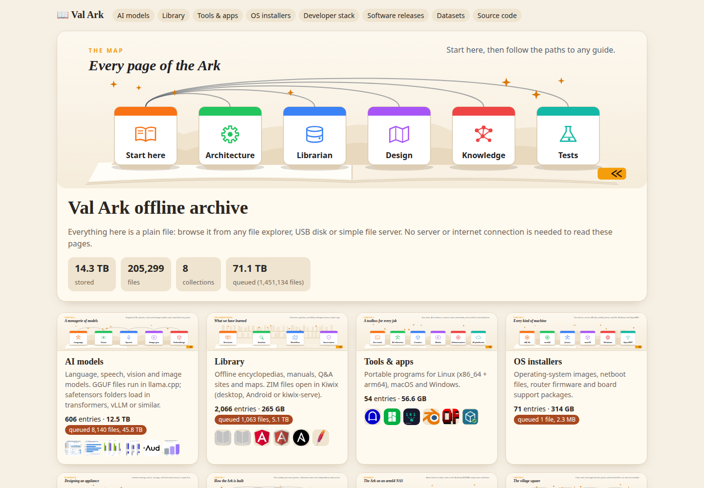
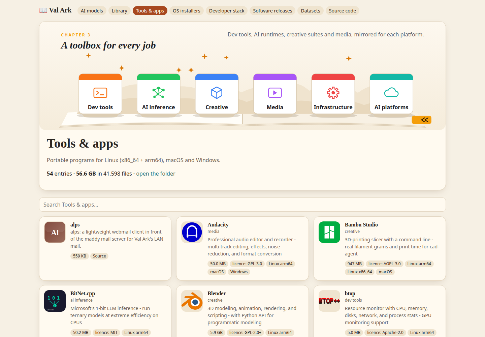
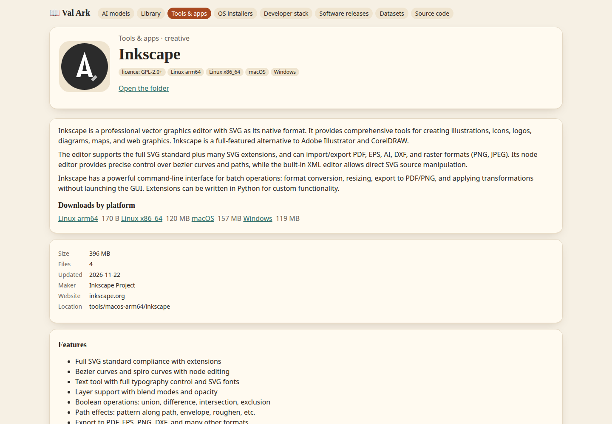
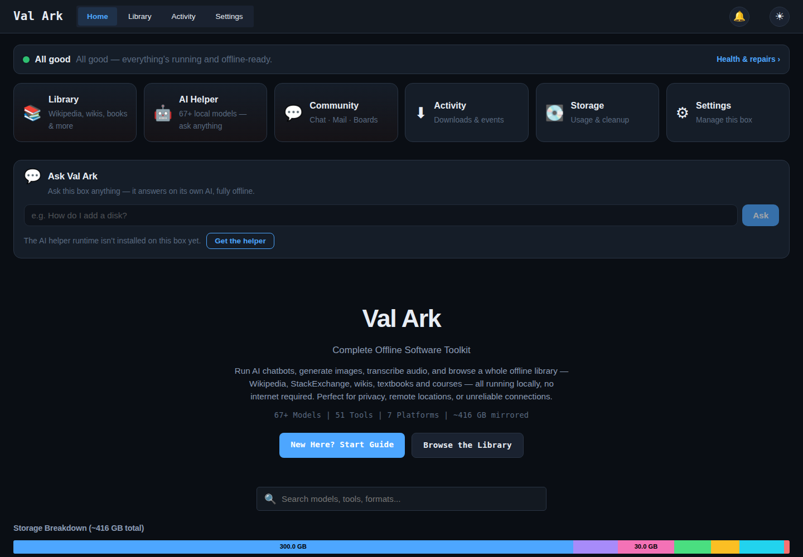
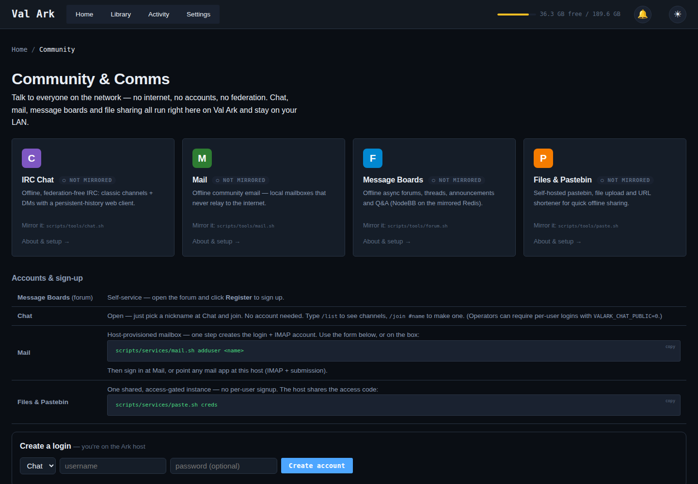
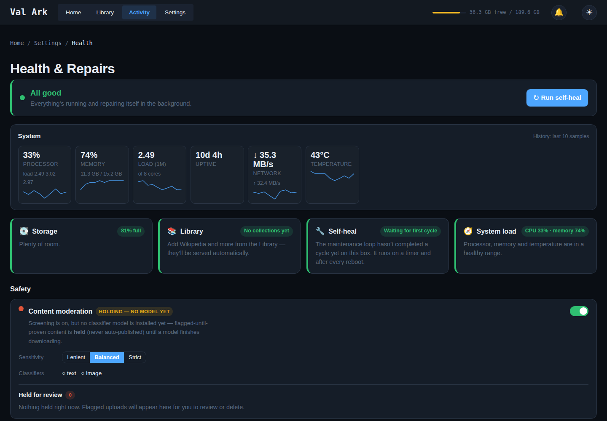

<picture>
  <source media="(prefers-color-scheme: dark)" srcset="img/popup/serving-dark.svg">
  
</picture>

# Val Ark - Two Ways to Serve: Static or Dynamic

[Back to Docs](README.md) | [Back to Project Root](../README.md)

An Ark's archive can be opened in two ways. **Both work fully offline**: neither needs the internet
once the disk is filled. They differ in what runs on the box:

- **Static:** plain HTML pages sit next to the files. Any file share can serve them, and nothing runs
  on the Ark itself.
- **Dynamic:** the Val Ark web server (`scripts/server.js`) runs. It adds live status, one-click
  downloads and the community services.

You don't have to choose once and for all. The static pages are written on every Ark, including one
that also runs the server, so you can use either mode or both at the same time.

## Which one should I use?

| | **Static: browse from a file share** | **Dynamic: run the web server** |
|---|---|---|
| **What runs** | Nothing; any file server you already have (SMB, NFS, a USB disk, `python3 -m http.server`, nginx) | `./start.sh serve` (zero-dependency Node.js), kept up by the 24/7 loop |
| **What you get** | A card grid per section and a page per item: picture, description, size, licence, platforms and direct links to the files | Everything in static, plus: live disk and health status, download progress, one-click requests for items not yet mirrored, the **Ask Val Ark** assistant, Wikipedia in the browser (kiwix-serve), chat, mail, message boards, file drop, and `/bootstrap.sh` to set up new nodes |
| **Reading ZIMs (Wikipedia etc.)** | Download the `.zim` file and open it in a Kiwix app (desktop or Android) | Read in the browser; the server starts kiwix-serve for you |
| **Changes the archive?** | No. It's read-only, so you can share the disk read-only | Yes: admins can request, pin, evict and repair, behind the chosen [Use Mode](design/access-identity.md) |
| **What needs securing** | Only the file share you already run | A web server and JSON API on the LAN: set a Use Mode, add [HTTPS](ENCRYPTION.md), keep it off the public internet ([SECURITY.md](../SECURITY.md)) |
| **Needs on the box** | Nothing beyond storage | Node.js (`./start.sh setup` installs a portable build), plus enough CPU and RAM for the services you enable |
| **Updates** | The pages are rewritten every few hours by `librarian.sh maintain`, or on demand with `librarian.sh site` | Live: every page reads the current state |

### Good fits for static

- **A NAS or file server you can't (or don't want to) run code on:** an appliance NAS, a locked-down
  corporate share, a router with a USB disk.
- **The simple, secure option:** a read-only SMB/NFS share has no login page, no API and no service
  to patch. People can only read and copy files.
- **A disk handed to someone:** a USB disk or a copy of the archive. Open `val-ark/index.html` in a
  file explorer; no setup and no install needed.
- **Machines that only need to browse:** a laptop that mounts the share to find an installer or a
  model.

### Good fits for dynamic

- **A community hub:** chat, mail, message boards and a shared file drop for everyone on the LAN.
  See [COMMUNITY.md](COMMUNITY.md).
- **People who use the box for its content:** Wikipedia, StackExchange and courses read in the
  browser with search; the on-box AI assistant.
- **An Ark you look after from a browser:** health and self-repair, storage, download progress,
  one-click requests for content and models.
- **Growing the fleet:** new machines install from the Ark itself
  (`curl -fsSL http://<ark-host>:3000/bootstrap.sh | bash`).

### Both at once

This is common. The Ark runs the server for people who want the full web UI, and shares its data
disk over SMB or NFS. Anyone who mounts the share can open `val-ark/index.html` with no server
involved. The static pages don't depend on the server, so they keep working if the server is
stopped.

## Static mode: step by step



*The static home page, opened straight from an SMB share: one card per section, with real totals.
A mirror that passes its download queue (`--pending`) also shows what is still downloading.*

1. **Write the pages.** On an Ark that runs the loop, `librarian.sh maintain` already rewrites them
   (at most every `VALARK_STATIC_SITE_HOURS`, default 6). To write them now:

   ```bash
   scripts/librarian.sh site
   ```

   This writes `index.html`, `browse/<section>.html` and `browse/item/*.html` into the archive folder
   (`<DATA_ROOT>/val-ark`). The [Librarian guide](LIBRARIAN.md#static-browse-pages) covers what goes
   on each card and the options for large trees.

2. **Share the whole data root**, not only `val-ark/`. Models live in `<DATA_ROOT>/models`, next to
   the archive folder, and the model pages link up to `../models`. Any of these works:

   | How | Example |
   |-----|---------|
   | SMB / Windows share | share `<DATA_ROOT>` (read-only is enough), then open `\\<ark>\<share>\val-ark\index.html` |
   | NFS | export `<DATA_ROOT>` read-only, mount it, open `val-ark/index.html` |
   | USB disk or a copy | open `val-ark/index.html` in a file explorer |
   | Any small web server | `python3 -m http.server 8000 --directory <DATA_ROOT>`, then browse to `http://<ark>:8000/val-ark/` |

3. **Browse.** Every page uses relative links and loads nothing from the internet. JavaScript is
   optional: when it runs, it adds a search box and group filters. Each item page has a description,
   the files and their sizes, platforms, licence and, for tools, features and screenshots.





To turn the pages off, set `VALARK_STATIC_SITE=0` in `.env`. If you open the dynamic UI's
`web-ui/index.html` from a file share by mistake, it shows a note pointing to the static
`index.html`.

## Dynamic mode: step by step



1. **Start the server:**

   ```bash
   ./start.sh serve            # port 3000; or ./start.sh serve 8080
   ```

   Set `VALARK_WEB_PORT` in `.env` so the loop checks the same port. `VALARK_WEB_PUBLIC_PORT=80`
   adds a redirect so people can type the bare address. See [`.env.example`](../.env.example).

2. **Keep it running.** The 24/7 loop restarts the server if it stops, and resumes after a reboot:

   ```bash
   ./scripts/loop.sh install 30
   ```

3. **Choose who can get in.** The first-boot wizard sets the **Use Mode**:
   - **Open:** anyone on the LAN can browse.
   - **Passworded:** one shared passcode.
   - **Accounts:** named users sign in.

   In every mode, changes need an admin. See [access-identity.md](design/access-identity.md). For
   HTTPS on the LAN, see [ENCRYPTION.md](ENCRYPTION.md).

4. **Turn on community services (optional).** For example, `VALARK_SERVICES="chat mail forum paste"`
   in `.env`. The loop starts each service, and the **Community** page shows its status with a
   one-click Start. See [COMMUNITY.md](COMMUNITY.md).





The server's API, routes and ports are described in
[ARCHITECTURE.md](ARCHITECTURE.md), and its security review in
[SECURITY-AUDIT.md](SECURITY-AUDIT.md).

## Security in one paragraph

Static mode puts nothing on the network beyond the file share you already have. Make that share
read-only and nobody can change the archive. Dynamic mode adds a web server and API. Run it only on
the LAN or a tailnet, never exposed to the internet. Pick a Use Mode that fits who is on the
network, and add HTTPS if the LAN isn't fully trusted. Running both is fine: the static pages give
read-only access, so you can share them more widely than the server.
