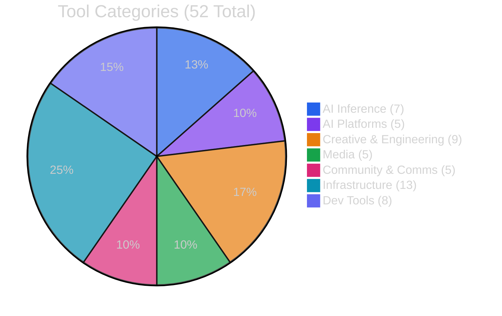

<picture>
  <source media="(prefers-color-scheme: dark)" srcset="img/popup/tools-dark.svg">
  
</picture>

# Val Ark - Tools Catalog (52 Tools)

[Back to Docs](README.md) | [Back to Project Root](../README.md)

These are the tool cards in the web UI (`TOOLS` in `web-ui/index.html`), grouped by its categories. Content mirrors (Lastbook, cad-agent references, git bundles) are listed under [Content mirrors](#content-mirrors).

---

## AI Inference (7)

Local inference engines for running AI models directly on hardware without cloud dependencies.

| # | Tool | Description | Platforms | Method | License |
|---|------|-------------|-----------|--------|---------|
| 1 | **llama.cpp** | LLM/VLM inference engine for GGUF quantized models with GPU offloading | arm64, x86_64, mac, windows | Prebuilt binary (mac/win), source build (Linux CUDA) | MIT |
| 2 | **whisper.cpp** | Fast speech-to-text using OpenAI Whisper models in C/C++ | arm64, x86_64, mac, windows | Prebuilt binary (win), source build (Linux CUDA / mac Metal) | MIT |
| 3 | **Piper TTS** | Fast neural text-to-speech with VITS/ONNX models, 51 languages | arm64, x86_64, mac, windows | Prebuilt binary | MIT |
| 4 | **stable-diffusion.cpp** | Image generation from text prompts (SD 1.x, SDXL, SD3.5, FLUX, Wan2.1) | arm64, x86_64, mac, windows | Prebuilt binary (mac/win), source build (Linux CUDA) | MIT |
| 5 | **ONNX Runtime** | Inference runtime for Kokoro TTS, Silero VAD, Moonshine ASR, and ONNX models | arm64, x86_64, mac, windows | Prebuilt binary | MIT |
| 6 | **Vosk** | Lightweight offline speech recognition (Kaldi-based), 30+ languages, streaming | arm64, x86_64, mac, windows | Prebuilt binary / pip | Apache-2.0 |
| 7 | **BitNet.cpp** | 1-bit (ternary) LLM inference, 2-6x CPU speedup over FP16 | arm64, x86_64, mac, windows | Source build (Python setup) | MIT |

---

## AI Platforms (5)

Higher-level AI services, workflow systems, and model management interfaces.

| # | Tool | Description | Platforms | Method | License |
|---|------|-------------|-----------|--------|---------|
| 8 | **Ollama** | Model manager and server for local LLMs with pull/run/serve workflow | arm64, x86_64, mac, windows | Prebuilt binary | MIT |
| 9 | **n8n** | Workflow automation platform with AI nodes, connects to Ollama/llama.cpp | arm64, x86_64 | npm / Docker | Sustainable Use |
| 10 | **Milvus** | Vector database for embeddings, similarity search, and RAG pipelines | x86_64 | pip (Milvus Lite) / Docker | Apache-2.0 |
| 11 | **ComfyUI** | Node-based image/video generation workflow editor using sd.cpp models | arm64, x86_64, mac, windows | pip / source (Python) | GPL-3.0 |
| 12 | **Open WebUI** | ChatGPT-style web interface for Ollama and local LLMs with RAG support | arm64, x86_64, mac, windows | pip / Docker | MIT |

---

## Creative & Engineering (9)

Design, modeling, content creation, and editing tools with scripting capabilities.

| # | Tool | Description | Platforms | Method | License |
|---|------|-------------|-----------|--------|---------|
| 13 | **Blender** | 3D modeling, animation, rendering with Python scripting API (bpy) | x86_64, mac, windows | Prebuilt binary | GPL-2.0+ |
| 14 | **FreeCAD** | Parametric 3D CAD modeler with headless mode (FreeCADCmd) and Python API | x86_64, mac, windows | Prebuilt binary | LGPL-2.1+ |
| 15 | **KiCad** | PCB/schematic EDA suite with kicad-cli for headless Gerber/BOM/DRC export | x86_64, mac, windows | Prebuilt binary (universal DMG / exe), package manager (Linux) | GPL-3.0+ |
| 16 | **cad-agent** | CAD verification toolkit (CadQuery, FEA, CFD, slicing): offline Python wheelhouse, git bundle, OpenFOAM image | arm64, x86_64, mac, windows | Wheelhouse (`pip --no-index`) + conda-forge set (arm64) + `docker load` image | MIT |
| 17 | **Bambu Studio** | 3D-printing slicer; its CLI gives cad-agent real filament grams and print time | x86_64, mac, windows | Prebuilt binary (AppImage/DMG/exe) | AGPL-3.0 |
| 18 | **Godot Engine** | 2D/3D game engine with GDScript, headless export, and CI integration | arm64, x86_64, mac, windows | Prebuilt binary | MIT |
| 19 | **GIMP** | Raster image editor with batch processing via Script-Fu and Python-Fu | arm64, x86_64, mac, windows | Prebuilt binary (AppImage/DMG/exe) | GPL-3.0 |
| 20 | **Inkscape** | Vector graphics editor (SVG) with CLI export to PDF/PNG/EPS | x86_64, mac, windows | Prebuilt binary (AppImage/DMG/exe) | GPL-2.0+ |
| 21 | **Kdenlive** | Non-linear video editor with multi-track timeline, effects, and titling | x86_64, mac, windows | Prebuilt binary (AppImage/DMG/exe) | GPL-3.0 |

---

## Media (5)

Media playback, recording, download, conversion and e-book tools.

| # | Tool | Description | Platforms | Method | License |
|---|------|-------------|-----------|--------|---------|
| 22 | **FFmpeg** | Audio/video processing, transcoding, streaming, and frame extraction | arm64, x86_64, mac, windows | Prebuilt binary | LGPL-2.1+ |
| 23 | **VLC** | Universal media player with CLI transcoding and HTTP streaming (cvlc) | arm64, x86_64, mac, windows | Prebuilt binary | GPL-2.0+ |
| 24 | **Audacity** | Multi-track audio editor with recording, effects, and noise reduction | arm64, x86_64, mac, windows | Prebuilt binary (AppImage x86_64 + aarch64, DMG, MSI) | GPL-3.0 |
| 25 | **yt-dlp** | Video/audio downloader supporting 1000+ sites with format selection | arm64, x86_64, mac, windows | Prebuilt binary | Unlicense |
| 26 | **Calibre** | E-book library manager, format converter, and content server | arm64, x86_64, mac, windows | Prebuilt binary | GPL-3.0 |

---

## Community & Comms (5)

Offline LAN messaging, mail, forums, file sharing and a git forge, run by `scripts/services/*.sh` and surfaced in the web UI's Community hub (see [COMMUNITY.md](COMMUNITY.md)).

| # | Tool | Description | Platforms | Method | License |
|---|------|-------------|-----------|--------|---------|
| 27 | **IRC Chat** | Offline, federation-free IRC (ngIRCd + The Lounge): channels + DMs with a persistent-history web client | arm64, x86_64, mac, windows | Source build (`scripts/services/chat.sh`) | GPL-2.0+ / MIT |
| 28 | **Mail** | Offline community email (maddy + alps): local mailboxes that never relay to the internet | arm64, x86_64, mac, windows | Prebuilt binary (Linux), source build (mac/windows) | GPL-3.0+ / MIT |
| 29 | **Message Boards** | Offline async forums, threads, announcements and Q&A (NodeBB on the mirrored Redis) | arm64, x86_64, mac, windows | Source build (Node) | GPL-3.0+ |
| 30 | **Files & Pastebin** | Self-hosted pastebin, file upload and URL shortener (MicroBin) for quick offline sharing | arm64, x86_64, mac, windows | Prebuilt binary | BSD-3-Clause |
| 31 | **Git Forge** | Self-hosted git forge (Gitea): repos, issues, pull requests, wikis and npm/PyPI/Cargo/Go/Debian/OCI package registries; optional LAN service at `/app/gitea/` | arm64, x86_64, mac, windows | Prebuilt binary (sha256-verified) | MIT |

---

## Infrastructure (13)

Networking, sync, databases, monitoring, self-hosting, and IoT messaging.

| # | Tool | Description | Platforms | Method | License |
|---|------|-------------|-----------|--------|---------|
| 32 | **SeaweedFS** | Distributed object/file store with S3-compatible API - fast blob layer for the fleet | arm64, x86_64, mac, windows | Prebuilt binary | Apache-2.0 |
| 33 | **Syncthing** | Peer-to-peer continuous file synchronization across devices | arm64, x86_64, mac, windows | Prebuilt binary | MPL-2.0 |
| 34 | **Coolify** | Self-hosted PaaS for deploying apps, databases, and services with Git push | x86_64 | Docker / install script | Apache-2.0 |
| 35 | **Kiwix** | Offline content server for ZIM archives (Wikipedia, StackOverflow, etc.) | arm64, x86_64, mac, windows | Prebuilt binary | GPL-3.0 |
| 36 | **Tailscale** | Mesh VPN / overlay network with zero-config device connectivity | arm64, x86_64, mac, windows | Prebuilt binary | BSD-3-Clause |
| 37 | **Mosquitto** | Lightweight MQTT broker and clients for IoT device messaging | arm64 | Source build (compiled) | EPL-2.0 / EDL-1.0 |
| 38 | **MQTT Explorer** | Visual GUI MQTT client for browsing topics and debugging IoT data flows | arm64, x86_64, mac, windows | Prebuilt binary (AppImage/DMG/exe) | CC-BY-ND-4.0 |
| 39 | **Redis** | In-memory key-value store for caching, pub/sub, and session management | arm64 | Source build (compiled) | RSALv2 / SSPLv1 |
| 40 | **PostgreSQL** | Relational database with pgvector extension for AI embeddings | arm64 | Source build (compiled) | PostgreSQL License |
| 41 | **InfluxDB** | Time-series database (OSS 2.x) for metrics and IoT data, mirrored with the influx CLI | arm64, x86_64, mac, windows | Prebuilt binary | MIT / Apache-2.0 |
| 42 | **Grafana** | Observability dashboards for InfluxDB, Prometheus, and 150+ data sources | arm64, x86_64, mac, windows | Prebuilt binary | AGPL-3.0 |
| 43 | **Telegraf** | Metrics collection agent with 300+ plugins for system and app monitoring | arm64, x86_64, mac, windows | Prebuilt binary | MIT |
| 44 | **SQLite** | Embedded SQL database CLI for experiment tracking, logs, and local storage | arm64, x86_64, windows | Prebuilt binary | Public Domain |

---

## Dev Tools (8)

Editors, runtimes, CLI utilities, and AI coding assistants.

| # | Tool | Description | Platforms | Method | License |
|---|------|-------------|-----------|--------|---------|
| 45 | **Helix** | Modal text editor (Rust) with built-in LSP, tree-sitter, and multi-cursor | arm64, x86_64, mac, windows | Prebuilt binary | MPL-2.0 |
| 46 | **VSCodium** | Open-source VS Code (telemetry-free) with Open VSX extension registry | arm64, x86_64, mac, windows | Prebuilt binary | MIT |
| 47 | **Miniforge** | Conda-forge distribution for managing Python environments and packages offline | arm64, x86_64, mac, windows | Prebuilt installer | BSD-3-Clause |
| 48 | **Python Standalone** | Portable CPython build with no system dependencies, pip included | arm64, x86_64, mac, windows | Prebuilt binary | MPL-2.0 |
| 49 | **Dev CLI Bundle** | ripgrep, fd, bat, jq, fzf, lazygit bundled as portable CLI dev tools | arm64, x86_64, mac, windows | Prebuilt binary | MIT / Apache-2.0 |
| 50 | **Claude Code** | Anthropic's agentic coding CLI, works offline via Ollama or llama.cpp backend | arm64, x86_64, mac, windows | npm | Proprietary |
| 51 | **btop** | Interactive system/resource monitor with CPU, GPU, memory, and process views | arm64, x86_64, mac, windows | Prebuilt binary | Apache-2.0 |
| 52 | **tmux** | Terminal multiplexer with session persistence, splits, and remote attach | arm64, x86_64, mac | Prebuilt binary (static) | ISC |

---

## Platform Support Matrix

All aarch64 boards (Jetson Orin, Jetson Thor, GB10) and OpenWRT routers share the
**same `tools/linux-arm64` artifacts**. See [PLATFORMS.md](PLATFORMS.md) for per-board
CUDA profiles and setup.

| Platform | Architecture | Examples / Notes |
|----------|-------------|------------------|
| linux-arm64 | ARM64 | Jetson Orin / Thor, GB10 Grace-Blackwell (SBSA), Raspberry Pi |
| linux-x86_64 | x86_64 | Ubuntu, Debian, Arch, Fedora |
| macos-arm64 | Apple Silicon | M1 / M2 / M3 / M4 |
| windows-x64 | x86_64 | Windows 10 / 11 |
| openwrt | ARM64 | Router nodes — content / sync / infra subset only (no inference engines) |

**Mesh:** the data disk is NFS-exportable, so fleet nodes can mount one shared mirror
and run GPU inference on the served models over the network. The 24/7 verify loop
(`scripts/verify.sh`) checks this; see [ARCHITECTURE.md](ARCHITECTURE.md).

---

## Download Methods

| Method | Description |
|--------|-------------|
| Prebuilt binary | Static binary or portable archive, runs immediately |
| Source build | Compiled from source with platform-specific flags (CUDA, Metal) |
| pip | Python package installed via pip into a virtualenv |
| npm | Node.js package installed globally via npm |
| Docker | Container image pulled and run via Docker/Compose |
| Wheelhouse | Python wheels for one platform, installed offline with `pip install --no-index --find-links` (see `scripts/tools/cad-agent.sh`) |
| Container archive | One platform of a container image as a `docker load` tar, pulled without Docker by `scripts/lib/oci_pull.py` |
| Package manager | Installed via apt, brew, or flatpak |

---

## Developer stack

The developer + security stack (`data/dev-stack.tsv`, about 230 projects: compilers, Docker,
Caddy, Headscale, Prometheus, databases, backup and security tools) is **not** in the tables
above and has no `TOOLS` entry. Its cards under **Library ▸ Developer stack** are generated
from the list and from what the box holds, so adding a row is all it takes to get a card
([LIBRARIAN.md](LIBRARIAN.md#developer--security-stack-release_mirrorpy)).

| To add | Where | Schema |
|--------|-------|--------|
| A project | `data/dev-stack.tsv` | `rank\|kind\|ref\|match\|group\|note` (the note is the card's description) |
| Its offline guide (card detail + `INSTALL.txt` beside the files) | `data/dev-stack-guides/<key>.md` | plain text with light markdown, about 60 lines at most |
| Its run check (`verify.sh`, Health page) | `data/dev-stack-checks.tsv` | `ref\|file\|binary\|args\|expect` |

Guides exist today for Gitea, the Docker static engine, Compose, Buildx, the registry
(distribution), Caddy, Headscale, Git for Windows, CMake, Ninja, KeePassXC, rclone, restic,
age, croc, Prometheus, node_exporter, Alertmanager, DuckDB, Go, the Temurin JDK and Ventoy.

## Content mirrors

Tool scripts that mirror a content release rather than an app, so they have no Software card.
They are also the exception to "tool output goes to `${TOOLS_DIR}`": Lastbook writes to
`content/lastbook/` (served; its card is in **Library ▸ Content**, fed by the `/api/status/content`
walk) and cad-agent-references writes to `private/` (never served, no card).

| Script | What it keeps | Where | In `download-tools.sh all`? |
|--------|---------------|-------|------------------------------|
| `scripts/tools/lastbook.sh` | [Lastbook](https://lastbook.org) (MIT), a free offline survival library: one content pack (Small 7.7 GB / Medium 67.5 GB / All 388 GB), state maps (~85 GB), address indexes (~5 GB), its GGUF model (16.9 GB), and every installer of the current app version (mac, Windows, both Ubuntu debs). Current release only, sha256-verified, resumable. | `content/lastbook/{packs,maps,addresses,models,app/<ver>}` + the three upstream manifests | **Yes, sized by the librarian's planner (#203):** each pack, state map (+ address index), the model and the installers are librarian candidates, so the planner's phases decide what fits next to the ZIMs, models and installers (one pack at most, since they nest; the survival profile takes the Small pack + installers as essentials; see [LIBRARIAN.md](LIBRARIAN.md#lastbook-planned-like-any-other-content)). `lastbook.sh` fetches the planned rows with `--pack auto --pack-limit <planned>` (that pack or a smaller one) and a budget of the planned bytes still to fetch; downloads stop at the reserve and the STOP flag. A Lastbook dir on another filesystem, or `VALARK_LASTBOOK_ADDRESSES=all` / a code list, also uses the share mode below. An operator-chosen selection (`VALARK_LASTBOOK_PACK` other than `auto`, `VALARK_LASTBOOK_BUDGET`, or the deprecated `VALARK_LASTBOOK_BUDGET_PCT`) is sized by the old share instead: Lastbook may hold `VALARK_LASTBOOK_BUDGET_PCT` (default 50) percent of (headroom above the reserve on its disk, capped by `VALARK_MAX_GB` when the dir is inside the data trees, + what it already holds). Once a larger pack is verified, the smaller packs nested in it are pruned, ranked by verified on-disk bytes, never by manifest sizes alone (not with `every`). `auto` steps up, never down: it never downloads a pack smaller than the one held (a same-id re-release of at least half its size excepted), so the held pack can be **frozen** (kept, not updated, exit 3) while the maps, addresses, model and installers keep refreshing. To force the current pack anyway: `VALARK_LASTBOOK_PACK=all`. **Every pack is opt-in** (`VALARK_LASTBOOK_PACK=every`, `MAPS=all`, `MODEL=yes`, ~570 GB) for servers and NAS mirrors. Preview: `scripts/tools/lastbook.sh plan`. |
| `scripts/tools/cad-agent-references.sh` | A private archive of every source cad-agent cites (git bundles, pages, PDFs) | `private/cad-agent-references/` (never served) | No: opt-in, run by hand (~37 GB, a day-long first pass) |
| `scripts/lib/git_bundle_mirror.py` | Full-history single-file git bundles of `data/source-repos.tsv` (+ `--top N` most-starred), each with a `.source.json` (sha256, bytes, head) and an `INDEX.txt` | `--dest DIR` (any disk or share; relative paths are fine) | No: opt-in, run by hand or from cron (`mirror --dest DIR`) |

`scripts/lib/lastbook_mirror.py` exit codes: `0` complete, `1` failure (manifest unreadable or
failed validation, a download or sha256 check failed), `3` incomplete (the budget or the disk left
part of the selection out, or `--pack auto` found no pack that fits), `64` usage. Only https URLs on
`downloads.lastbook.org`, `lastbook.org` and `huggingface.co` are fetched; any other URL in a
manifest fails the run. A 206 whose `Content-Range` does not start at the `.part` size restarts
from 0; a 404 / 410 fails that file at once instead of retrying. Prune removes only files the tool
recorded (plus stray `*.part`s whose section/[version/]name path a current or previously kept
manifest gives), never a held pack unless this run verified a pack at least as large on disk (a pack re-released
under a new name replaces its old file once the new one verifies with at least half its bytes; a
pack that would displace a held one is HEAD-confirmed first, and a failed HEAD keeps the held pack), and refuses
when the release looks truncated, including maps, addresses or models each losing more than half of
their held files while the release lists fewer than are held. Decision record:
[decisions.md](knowledge/decisions.md#202611--lastbook-auto-sized-by-default-every-pack-opt-in-181).

**Source bundles: I/O cost.** `git_bundle_mirror.py` I/O:
- **Every refresh reads each due bundle in full.** Each `--refresh-days` (30 by default), every
  repo that is due gets its archived bundle read and sha256-hashed against `.source.json` before
  the "unchanged" skip is trusted. A torn or bit-rotted bundle is rebuilt instead of kept.
- **An unchanged repo is never rewritten.** Over a network share, one refresh still reads about the
  whole mirror (hundreds of GB for the full catalog).
- **A changed repo is also read once** to seed the incremental fetch, then rewritten.
- **`verify` is a full read:** `git bundle verify` plus a sha256 of every byte of every bundle.
  Schedule it like a scrub, not like a health ping.

`verify` exit codes:
- `0`: every bundle is good.
- `2`: any bundle is bad, or there are none.
- `3`: the only problem is bundles with no valid `.source.json`. That means missing, empty,
  `[]`, garbage, or lacking an integer `bytes` and a 64-hex `sha256`. They are listed as
  `UNVERIFIED … no provenance`, because git's own verify passes a truncated bundle and so cannot
  vouch for them. One bad bundle or sidecar never stops the walk over the rest.

`verify --adopt` writes a `.source.json` for those from their current bytes, but only after
`git bundle verify`, a full bare clone, and `git fsck --full` in a scratch dir under `--stage`.
Clone alone accepts a malformed commit. That needs about one repo's worth of free space there.
A bundle that fails any step is reported `BAD` and is not adopted. Leftover `.adopt-*` scratch
dirs older than a day (from a killed run) are removed when `verify` starts. Likewise,
`<owner>/<repo>.bundle.part` files older than a day, left by a copy that was killed mid-way, are
removed when `mirror` starts. A fresh `.part` may belong to a copy in flight and is kept. The
sweep never leaves the `--dest` tree. A `.part` whose owner directory is a symlink, or resolves
outside `--dest`, is skipped, and a `.part` that is itself a symlink is not a regular file
(checked with `lstat`), so it is skipped too.

**Adopting trusts the bundle's current header.** Ref names and the commits they point to carry no
checksum, so a renamed or repointed ref (to an object that exists) cannot be detected. Only adopt
bundles whose origin you trust. A refresh from upstream replaces the adopted provenance anyway.

Bundle bytes are fsync'd before the `.part` rename and the sidecar after it, each followed by a
directory fsync. After a power cut you may get a new bundle with the old sidecar: that reads as a
mismatch and gets rebuilt. You never get a torn pair that passes.

---

## No upstream build for a platform? Offline install + source

Some apps publish no build for a platform: Linux arm64 for **Inkscape, Blender, Kdenlive,
KiCad, VLC and Bambu Studio**, Linux x86_64 for KiCad and VLC (distro packages only), macOS
for btop and tmux. Their tool scripts (`build_from_source_hint` in
`scripts/tools/_common.sh`) write an `INSTALL.txt` that names every offline way in:

1. **The `desktop-apps` .deb set** (`data/apt-sets.tsv`, ~1.2 GB per arch): Ubuntu's
   package with every dependency, as a flat repo for `apt-get install` with no internet.
2. **The `desktop-src` set** (~2.7 GB per arch): Ubuntu's source package (`source/<pkg>/`)
   plus every build dependency, so `apt-get build-dep ./<pkg>_*.dsc` + `dpkg-buildpackage`
   work offline (the flat repo has no deb-src index, so build-dep by package NAME fails).
   These are the Ubuntu suite's versions, which can be older than upstream's.
3. **The upstream source tarball**, mirrored by the script to
   `tools/sources/<tool>-<version>-src/` (`mirror_source_tarball`; older versions are pruned),
   with the upstream build commands. A maintainer-made release tarball usually bundles its
   submodules / vendored code; a forge's auto-generated tag archive (KiCad's GitLab archive,
   Bambu Studio and btop on GitHub) does not, and the hint says which one it is. A newer
   upstream release may need newer libraries than the `desktop-src` build deps. Libraries a
   source build needs beyond the OS are mirrored too (libevent for tmux on macOS).
4. **The full-history git bundle** of the upstream repo (`data/source-repos.tsv`).

Bambu Studio's own build script downloads third-party sources while it builds, so its
hint says so and points at the x86_64 AppImage or OrcaSlicer (which ships arm64 builds).

## Build From Source

There is **no upstream prebuilt aarch64 CUDA binary** for llama.cpp, whisper.cpp, or
stable-diffusion.cpp, so GPU acceleration on Jetson / GB10 requires a source build.
`scripts/download-tools.sh` clones the source repos; you then compile with the right
acceleration flag for your platform. A box with no CMake gets it, and Ninja, from
**Library ▸ Developer stack** (`dev-stack/toolchains/Kitware/CMake/` and
`dev-stack/toolchains/ninja-build/ninja/` on the disk; each has an `INSTALL.txt`):

| Platform | Flag | Notes |
|----------|------|-------|
| Jetson Orin | `-DGGML_CUDA=ON -DCMAKE_CUDA_ARCHITECTURES=87` | SM 8.7 |
| Jetson Thor / GB10 | `-DGGML_CUDA=ON -DCMAKE_CUDA_ARCHITECTURES=110` | Blackwell |
| Linux x86_64 | `-DGGML_CUDA=ON` | CUDA auto-detect; CPU build also auto-tunes AVX2/AVX-512/FMA |
| macOS | `-DGGML_METAL=ON` | Metal (llama.cpp / sd.cpp prebuilt already include it) |

See [PLATFORMS.md](PLATFORMS.md) for full per-board build commands.

---

## Related Docs

- [LIBRARIAN.md](LIBRARIAN.md) — the librarian engine that auto-fills the mirror disk
- [PLATFORMS.md](PLATFORMS.md) — per-platform setup and CUDA/Metal builds
- [ARCHITECTURE.md](ARCHITECTURE.md) — system architecture, the 24/7 self-healing loop, and the NFS mesh
- [MODEL_INVENTORY.md](MODEL_INVENTORY.md) — AI model catalog and tiers
