<picture>
  <source media="(prefers-color-scheme: dark)" srcset="../img/popup/access-identity-dark.svg">
  
</picture>

# Val Ark — Access & Identity

Part of the [design hierarchy](README.md). Answers: *Can the operator choose open vs.
accounts? Are there real access controls? What's admin vs. user?* (See
[recovery.md](recovery.md) for the lockout/forgot-password side.)

## The core idea: one Admin, a choosable "who can use it," and localhost is always trusted

<picture>
  <source media="(prefers-color-scheme: dark)" srcset="../img/flow/access-dark.svg">
  
</picture>

Three independent layers, from bottom to top:

```
┌───────────────────────────────────────────────────────────────┐
│ 3. USE MODE (operator picks)   Open · Passworded · Accounts     │  ← "who can get in"
├───────────────────────────────────────────────────────────────┤
│ 2. ADMIN                       always exactly one admin identity │  ← "who can change things"
├───────────────────────────────────────────────────────────────┤
│ 1. NETWORK FLOOR (automatic)   localhost/console = trusted;      │  ← the safety net
│                                LAN + tailnet allowed; public denied
└───────────────────────────────────────────────────────────────┘
```

### Layer 1 — Network floor (automatic, not a user setting)
- **The box's own console and `localhost` are always trusted as admin.** Physical/loopback access means you own the device — this is what makes recovery possible with no password.
- **LAN + tailnet** are allowed to reach the box; **the public internet is always denied**: every change and request (the LAN/tailnet POST gate) and, in every Use Mode, every read of the library (#297).
- This floor is invisible to Jordan; it just makes "on the box" and "on my network" safe.
- **Tailscale in userspace-networking mode breaks this floor, so the box watches for it (#311).** With `tailscaled --tun=userspace-networking` there is no interface: tailscaled accepts a tailnet peer's connection itself and connects onward from 127.0.0.1, so every tailnet peer looks like the box's own console, the Admin. Every loop cycle (step 2g) and the server (at startup and every 10 minutes) run a read-only detector, `scripts/lib/tailscale-mode.sh`. When `tailscale status --json` answers with BackendState `Running`, its `"TUN"` field decides; `true` is fine unless a second tailscaled proven to share the box's network (a container with `network_mode: host`) runs with `--tun=userspace-networking`. Otherwise it looks at every tailscaled process: `--tun=userspace-networking` in its command line, or no `tailscale0` (or its `--tun=NAME`) interface, flags it. A tailscaled in another network namespace (a container with its own network, like the official image, which defaults to userspace networking) is skipped, because its 127.0.0.1 isn't the box's. The namespace comes from `/proc/<pid>/ns/net`, or, when that isn't readable (root's daemon, non-root server), from the inode of the world-readable `/proc/<pid>/net/dev`, which differs per network namespace. Only when neither can be read does a container cgroup (docker, containerd, kubepods, libpod, lxc, machine.slice) make it a **warning** ("could not check"), never the critical alarm. The result goes to `state/tailscale.json`; the notification bell gets a **critical** "Tailscale is giving every tailnet device admin rights" item and the Health page a red "Tailnet access" card. The fix: run tailscaled with a kernel TUN interface (in a container: `/dev/net/tun` + `NET_ADMIN`), or stop Tailscale on the box.
- **Why the box doesn't just stop trusting 127.0.0.1 when it sees this:** the real console and tailscaled's proxied peers both arrive from 127.0.0.1, and nothing in the connection tells them apart reliably (the socket owner's uid is the closest hint, and it fails whenever tailscaled and the console user are the same account, as in most containers). Refusing every loopback request would lock the console out of its no-password recovery path, so the box warns loudly and leaves the fix to the operator. The `scripts/valark` CLI still works for recovery either way.

### Layer 2 — Admin (always present)
- Exactly **one Admin** is created during first-boot commissioning ("Set an admin passcode so only you can change settings" — with a clear "or skip for now" that still lets localhost administer).
- Admin can: change any setting, manage users, start/stop services, trigger/cancel downloads, update, back up, factory-reset.
- **From the box's console or `localhost`, you are Admin without logging in.** From the LAN, Admin actions require the admin passcode (unless Use Mode = Accounts, where an admin *account* logs in).

### Layer 3 — Use Mode (the operator's choice, set at commissioning, changeable anytime)

| Mode | Who can **view/use** (Library, AI, apps) | Who can **change settings** | Best for |
|------|------------------------------------------|-----------------------------|----------|
| **Open (household)** *(default)* | Anyone on the LAN — no login | Admin only | A trusted home |
| **Passworded** | Anyone with the one shared passcode (like a guest-Wi-Fi password) | Admin only | A home you want lightly gated |
| **Accounts** | Named users sign in (Member / Guest roles) | Admins (a role) | A shared community box, a school, a clinic |

- **Open** is the friendliest default and matches "a trusted LAN appliance."
- **Passworded** is one field: a single household code. No user list to manage.
- **Accounts** adds named users + roles (**Admin**, **Member**, **Guest**), individual logins, and optional per-app access (e.g. "Guests can read the Library but not the forum").

Jordan sees this as one plain-language screen: **"Who can use Val Ark?"** → *Everyone on my network* / *People with a code* / *Only accounts I create*. Advanced role/permission detail is one tap deeper and only exists in Accounts mode.

## Real controls this gives you

- **Read gate** (view the site) — per Use Mode.
- **Use gate** (community apps, requesting downloads) — per Use Mode + optional per-app rules in Accounts mode.
- **Admin gate** (settings/system/users/updates/reset) — Admin only, always; localhost/console bypass for recovery.
- **Rate limiting + lockout** on the passcode/login (already partly present for triggers) to resist guessing.
- **Sessions** — a signed cookie after login; "sign out everywhere" for the admin.
- **Audit line** — a plain "who did what, when" list in the admin console (who started a download, who added a user).

## How it maps to what exists today

- The **LAN/tailnet/localhost POST gate** and **rate limiter** are already built — they become Layer 1.
- The community-service credentials (chat/mail/paste) stay as each service's *own* logins, but the **Accounts** mode can optionally provision matching service accounts so a user has one identity across the box (a later phase; see [roadmap.md](roadmap.md)).
- Nothing here requires the public internet; the whole model is decided and enforced locally.

## Threat model (kept honest, in plain terms)

- This protects against **casual access on the network** and **accidental changes**, and it makes **recovery safe**. It is a home/community appliance, not a bank.
- **Community apps share the box's web origin** (`/app/<id>/`), and the box's own browser is the Admin. So what people upload to them (paste files, forum uploads, chat uploads, mail parts) is served in a browser sandbox with no access to Val Ark's cookies or API, and the API refuses calls from pages under `/app/` or `/kiwix/` (#317, details in [COMMUNITY.md](../COMMUNITY.md#security-model)). The session cookie is `HttpOnly; SameSite=Lax; Path=/` (the read-wall needs it on `/app/` too) and is never forwarded to an app. The apps' web ports always bind `127.0.0.1`, whatever `VALARK_BIND` says, so nobody reaches them around these checks. What's left (#327): a script-injection bug in an app's own pages would still run as Val Ark, and so would script in a ZIM page: `/kiwix/` is not sandboxed (ZIM HTML runs same-origin; ZIMs come from the curated catalog, not from users). On a shared box keep the community apps up to date, and sign out of the admin session when you're done.
- Val Ark is explicitly **not** exposed to the public internet; HTTPS via the local CA (see the [HTTPS guide](../ENCRYPTION.md)) encrypts LAN traffic. Data at rest is not hidden from whoever physically holds the box — which is the correct model for a device you own.

## Defaults we ship

- Use Mode: **Open (household)**.
- Admin: **created at first boot** (with a friendly "you can skip and set it later; until then, only this box/localhost can change settings").
- Public internet: **denied**, for changes, requests and library reads alike (#297); LAN + tailnet: **allowed**; localhost/console: **admin**. A reverse proxy or tunnel on the box (nginx, Caddy, cloudflared, Tailscale Funnel) makes every visitor look like localhost, so don't put one in front of an Ark.
- **What counts as LAN** (`isLanOrTailnet` in `scripts/server.js`): the box itself; IPv4 10/8,
  172.16/12, 192.168/16 and 169.254/16; IPv6 ::1, ULA (fc00::/7), link-local (fe80::/10) and a
  global address on a /64 (or longer) of an interface that also has a private IPv4 (a home LAN,
  not a cloud uplink). **Tailnet:** 100.64/10 only when the request arrived on Tailscale's own
  interface (`tailscale0`, or a macOS `utun` with Tailscale's `fd7a:115c:a1e0::/48` address);
  everything else is the internet. **Don't run Tailscale in userspace-networking mode on an
  Ark** (common in containers and on some NAS boxes): with no interface, tailscaled connects
  onward from 127.0.0.1, so every tailnet peer looks like the box itself, the Admin.

> Design note: reconcile with research patterns (Synology's per-user + admin-group model,
> Home Assistant's owner + users, Umbrel's single-password model, routers' admin-password +
> guest-network split, and physical **reset-button** recovery) — captured in
> [research-brief.md](research-brief.md).
