<picture>
  <source media="(prefers-color-scheme: dark)" srcset="../img/popup/commissioning-dark.svg">
  
</picture>

# Val Ark — First-Boot Commissioning

Part of the [design hierarchy](README.md). The single most important experience: a fresh
box → a working Ark in ~5 minutes, in a browser or on the box's own screen, with **zero
files, flags, or jargon**. Replaces today's `.env` + `./start.sh` CLI path.

## How Jordan reaches the box (the hard part first)

A new box must be *findable* without knowing an IP:
- **`valark.local` via mDNS/Bonjour** (avahi) — the box advertises itself; Jordan opens `http://valark.local/` from any phone/laptop on the same network. *As built (#306):* `scripts/lib/mdns.sh` publishes `<name>.local` after setup and on every loop cycle (step 2h) when it can: the hostname already is the name (avahi or macOS answers for it), or avahi-daemon runs and `avahi-publish` is installed (one kept-up `avahi-publish -a -R <name>.local <lan-ip>` child; no root needed). It never installs packages. When it can't, the wizard, the recovery card and the Health page show the box's LAN IP instead and say why `.local` is unavailable (one decision, `boxAddress()` in `server.js`). "Published" means the publisher is up and announcing, not that every client resolves `.local` (some phones and Windows setups don't), so the IP is always shown beside it.
- **The box's own screen** — if a monitor is attached, it boots to a **local console** that either (a) runs the wizard full-screen in a kiosk browser, or (b) shows big text: *"Open http://valark.local on your phone — or press a key to set up here."*
- **A printed quick-start card / label** on the device: the name, `valark.local`, and the rescue gestures.
- Fallback: the console/screen prints the raw `http://<ip>/` if `.local` resolution fails. *As built:* the server prints every address it listens on at start-up.

> No step ever asks Jordan to "find the IP" or "SSH in." Discovery is the box's job.

## The wizard — screens

<picture>
  <source media="(prefers-color-scheme: dark)" srcset="../img/flow/setup-dark.svg">
  
</picture>

Each screen: one question, a smart default already filled, a big **Continue**, and an
optional **"Advanced"** disclosure. Progress dots at the top ("Step 2 of 6").

*As built* (`_setupSteps` in `web-ui/index.html`; the code wins where it differs from the
design below): Welcome → Setup code (only when you are not on the box) → Name → Admin passcode
(skippable) → Who can use it → Focus → Ready to go → All set (the address, the recovery card,
the first fill). The Storage and "Make it easy to open" screens below are not built.

1. **Welcome** — *"Welcome to Val Ark, your offline knowledge box. This takes about 5 minutes — no accounts, no internet needed."* → **Start**.

2. **Storage** — *"Where should Val Ark keep everything?"*
   - Auto-detects the largest healthy disk, **pre-selected**, showing "1.8 TB free."
   - A friendly cap: *"Val Ark can use up to ___"* with a slider defaulting to most of the disk (leaving headroom). Plain: "This is how much space Val Ark may fill."
   - Advanced: choose a specific disk/folder; NFS/pool notes. (Maps to `VAL_ARK_DATA`, `VALARK_MAX_GB`.)

3. **Name** — *"What should we call this box?"* default `valark` → publishes `valark.local` (it does not change the system hostname). Explains "You'll open it at http://valark.local/" only when this box can publish a `.local` name; otherwise "You'll open it at http://&lt;lan-ip&gt;:&lt;port&gt;/" and that `.local` is unavailable, with the reason (no avahi, daemon stopped, `avahi-publish` missing).

4. **Who can use it** — the [access model](access-identity.md) as one plain screen:
   - *Everyone on my network* (Open) · *People with a code* (Passworded) · *Only accounts I create* (Accounts).
   - Then *"Set an admin passcode so only you can change settings"* (with **"Skip — I'll set it later"**; until set, only the box/localhost can administer).

5. **What do you want on it?** — the plain-language topic picker (see [downloads-monitoring.md](downloads-monitoring.md)):
   - Big toggles with icons: **Wikipedia**, **How-to & Repair**, **Health & Medicine**, **Kids & School**, **Maps & Travel**, **AI Helper**, **Software & Tools**, **Chat, Mail & Boards for my network**.
   - A sensible **starter set pre-checked** (Wikipedia + How-to + AI Helper + a setup-assistant). A live estimate: *"~40 GB — about 20 minutes on a fast connection; keeps working offline after."*
   - The box translates these into curation priorities + which services to enable. Advanced: the full catalog.

6. **Make it easy to open** — *"Want people to just type http://valark.local (no extra numbers)?"* → one tap enables **port 80** ([setcap/redirect](../../start.sh)). Shows the final address(es) to share.

7. **All set!** — *"Val Ark is ready. I'm downloading your first content now — watch it on the home screen. It'll keep working even if the internet goes away."* → drops into the **home screen** with the first downloads already running. *As built (#306):* the screen shows the address to open (from `boxAddress()`), and says filling has started when commissioning started it. If the 24/7 loop isn't installed, it says how to make it permanent; Home keeps a "Filling has started" card with an admin-only **Keep it healthy 24/7** button (runs `loop.sh install 30`) and the command, until the loop is installed.

## What the wizard does under the hood (so Jordan never sees it)

- Writes `.env` (data root, cap, services, port) — never shown as a file.
- Runs `setup.sh` headlessly (`VALARK_YES`) to install deps + Node (from the source Ark if this was bootstrapped, else the internet).
- Publishes `<name>.local` over mDNS when the box can (`lib/mdns.sh ensure`, above), enables port 80 if chosen.
- Starts filling: if no `val-ark-loop` cron entry exists, `POST /api/setup/commission` starts ONE bounded `loop.sh once` in the background (fixed argv, detached, fd 8 closed, the same deduped spawn as "Run self-heal"; its fill step is capped by `LOOP_FILL_SECONDS`) and records it in `state/first-fill.json`. If the loop is already installed, its next cycle fills. *As built, it does not install the cron itself:* that writes the user's crontab, so it is the admin's explicit choice (Home's admin-only **Keep it healthy 24/7**, `POST /api/setup/loop-install`, or `./scripts/loop.sh install 30`).
- Seeds curation priorities from the topic picks.
- Creates the admin identity ([access-identity.md](access-identity.md)).

## Headless with *no* second device

If there's a monitor but no phone/laptop handy, a minimal **on-screen console wizard** (TUI)
covers the essentials — storage, name, admin — then says *"Finish the rest at http://valark.local
whenever you like; downloads have started with good defaults."* The box is usable immediately
with defaults; nothing is blocked on finishing every screen.

## Re-running / changing later

- Every choice here is just the first pass at settings that live in the [admin console](admin-console.md); nothing is one-way.
- A **factory reset** ([recovery.md](recovery.md)) re-runs this exact wizard.

## Design cues from comparable products (see [research-brief.md](research-brief.md))
- Synology **Web Assistant** (`find.synology.com` / `valark.local`) → guided create-admin → Storage Pool wizard.
- Home Assistant onboarding (name/location → create owner → auto-discovery → done, usable immediately).
- Umbrel/CasaOS (single friendly password, then a home dashboard).
- Router apps (find device → name it → set admin password → guest-vs-admin → "you're online").
